# Design for Learning: Decoded Learning about Learning Mind Map

*Working draft · 18 November 2026 (decoded from 10 March 2023 XMind map) · Domi Jin*

> **A native Mermaid and plain-text decoding of the 10 March 2023 XMind map (`Design for Learning`), restoring every branch, boundary annotation, summary frame, icon marker and embedded reference link in place of serving the raw PDF.**

This reading map was created in XMind on 10 March 2023 as part of early thinking behind [Open Learning: From Individual Potential to Collective Discovery](/articles/blog/open-learning.html). Rather than serving an opaque 103 kB PDF export, this page decodes the diagram into native Mermaid figures, structured notes and clickable references.

## How the XMind notes and markers decode

The original 10 March 2023 single-page XMind export (`Xmind/22.11.3656`, `1191.1 × 841.9 pt`) carried four kinds of visual metadata alongside the topic hierarchy. No hidden pop-up note bodies or collapsed child text were embedded in the PDF's annotation or file streams—the only PDF annotations were the 13 external hyperlinks below—so every note decoded here comes faithfully from the diagram's visible annotations, markers and link targets:

- **Boundary annotations (white-on-navy callouts):** XMind boundaries wrapping subtrees with a framing note (for example, `bias toward practical`, `personal tutoring -> informative, interactive, adaptive`, `vision: make scientific research on learning more accessible`, `six-year plan since 2017?`, Eric Mazur's five framing labels, `Marva Collin`, `critique Design Thinking for Education`, and Alvin Toffler's strategy quotation).
- **Summary frames and directional tags:** Dotted summary braces (`first principle of instruction`, `Effective Learning Strategies`, `No silver bullet, small effect is common`, `Effective Solution`) and inline `->` elaborations (`-> anki`, `-> promotive & comparative learning -> first principle thinking`, `-> archival skills & multi-modal thinking -> design thinking`).
- **Topic-note (`≡`) and detail (`…`) markers:** XMind note icons appear on `Instructional design`, `problem-centered`, `activation`, `demonstration`, `application`, `Teaching philosophies`, `direct/explicit instruction (science of learning)`, `Education theory/framework`, `Positive Psychology (resilience/growth mindset)`, `No silver bullet, small effect is common`, `Design Thinking (effective communication)`, all five stages under `Donald Clark`, and `wider view of AI`. Circular ellipsis (`…`) markers appear on `Donald Clark` and `WildFire: AI for learning`.
- **Folded subtopic badges:** Three nodes under `first principle of instruction` show folded child counts from the original XMind workspace: `problem-centered` (`5` folded), `activation` (`3` folded) and `demonstration` (`3` folded). Their collapsed subtopics were not expanded in the 2023 PDF export.

## Overview mind map

<figure class="learning-figure">

<figcaption>Top-level Mermaid mindmap decoded from the 10 March 2023 XMind root <em>Design for Learning</em>. <a href="/articles/diagrams/learning-about-learning-overview.svg">Open diagram</a> · <a href="/articles/diagrams/learning-about-learning-overview.mmd">Mermaid source</a>.</figcaption>
</figure>

## 1. Instructional design

<figure class="learning-figure">

<figcaption>Branch 1: Instructional design, boundary framing and folded Merrill principle counts. <a href="/articles/diagrams/learning-about-learning-instructional.svg">Open diagram</a> · <a href="/articles/diagrams/learning-about-learning-instructional.mmd">Mermaid source</a>.</figcaption>
</figure>

### Decoded notes — Instructional design

- **Parent node:** `Instructional design` *(carries a topic-note marker in the 2023 map)*.
- **Core dimensions:** `systematic`, `reflective`, `cognitive`, `constructive`.
- **Boundary annotation:** **`bias toward practical`** wraps the summary subtree `first principle of instruction` (M. David Merrill's five principles).
- **Summary subtopics:**
  - `problem-centered` *(topic-note marker; `5` folded subtopics in the original XMind file)*.
  - `activation` *(topic-note marker; `3` folded subtopics)*.
  - `demonstration` *(topic-note marker; `3` folded subtopics)*.
  - `application` *(topic-note marker)*.
  - `integration`.

## 2. Teaching philosophies

<figure class="learning-figure">

<figcaption>Branch 2a: Teaching philosophies, personal tutoring framing, and Learning Scientists strategies. <a href="/articles/diagrams/learning-about-learning-philosophies.svg">Open diagram</a> · <a href="/articles/diagrams/learning-about-learning-philosophies.mmd">Mermaid source</a>.</figcaption>
</figure>

<figure class="learning-figure">

<figcaption>Branch 2b: Barbara Oakley's <em>Learning How To Learn</em> tools and Khan Academy resources under the personal tutoring boundary. <a href="/articles/diagrams/learning-about-learning-oakley-khan.svg">Open diagram</a> · <a href="/articles/diagrams/learning-about-learning-oakley-khan.mmd">Mermaid source</a>.</figcaption>
</figure>

### Decoded notes & links — Teaching philosophies

- **Parent node:** `Teaching philosophies` *(topic-note marker)*.
- **Outer boundary annotation:** **`personal tutoring -> informative, interactive, adaptive`** frames the entire `Teaching philosophies` subtree—linking the three experience principles that later shaped [Open Learning](/articles/blog/open-learning.html) directly to the tension between discovery-based and explicit instruction.
- **Branch A:** `social constructivist/discovery based learning`.
- **Branch B:** `direct/explicit instruction (science of learning)` *(topic-note marker)*:
  - **`for educators, LearningScientist`** — [learningscientists.org](http://learningscientists.org/)
    - **Boundary annotation:** **`vision: make scientific research on learning more accessible`** wraps three goals:
      - `Motivate students to study`
      - `Increase the use of effective study and teaching strategies that are backed by research` — [Downloadable Materials](https://www.learningscientists.org/downloadable-materials)
      - `Decrease negative views of testing`
    - **Summary brace — `Effective Learning Strategies`** with decoded `->` follow-on notes:
      - `Spaced Practice` → **`-> anki`**
      - `Retrieval Practice`
      - `Elaboration` → **`-> promotive & comparative learning -> first principle thinking`**
      - `Interleaving`
      - `Concrete Examples`
      - `Dual Coding` → **`-> archival skills & multi-modal thinking -> design thinking`** — [Dual Coding / book link (Amazon)](https://www.amazon.com/dp/113856172X/ref=cm_sw_r_cp_ep_dp_TrhABbQ1CCH4H)
  - **`for students, Barbara Oakley`** — [Learning How to Learn (barbaraoakley.com)](https://barbaraoakley.com/books/learning-how-to-learn/)
    - **Boundary annotation:** **`Book: Learning How To Learn`** wraps:
      - `tools & methodologies`: `6 effective strategies`; `focused & diffuse mode: switch topic when frustrated`; `brain-links with practice, repetition, and recall`; `exercise, test - feedback loop`; `start difficult work first, let diffuse help`
      - `MOOC` — [Coursera: Learning How to Learn](https://www.coursera.org/learn/learning-how-to-learn?action=enroll#syllabus)
  - **`resources - Khan Academy`** — [khanacademy.org](https://www.khanacademy.org/): `STEM`, `Life skills`.

## 3. Education theory / framework

<figure class="learning-figure">

<figcaption>Branch 3: Carl Wieman's course transformation model and Eric Mazur's five labelled practice groups. <a href="/articles/diagrams/learning-about-learning-frameworks.svg">Open diagram</a> · <a href="/articles/diagrams/learning-about-learning-frameworks.mmd">Mermaid source</a>.</figcaption>
</figure>

### Decoded notes & links — Education theory / framework

- **Parent node:** `Education theory/framework` *(topic-note marker)*.
- **`Carl Wieman - active learning [higher ed]`** — [Inside Higher Ed (27 June 2017)](https://www.insidehighered.com/news/2017/06/27/carl-wieman-makes-evidence-based-plea-better-science-instruction-new-book)
  - **Boundary annotation:** **`six-year plan since 2017?`** wraps `course transformation process`:
    - `What should students learn`
    - `what are students learning`
    - `which instructional practices will improve student learning`
  - Sibling note: `improving how universities teach science`.
- **`Eric Mazur`** — [Harvard Instructional Moves: Eric Mazur](https://instructionalmoves.gse.harvard.edu/eric-mazur)
  - **Boundary `OKR`:** `Project-based learning`, `Team-based learning`
  - **Boundary `Peer Learning / Collaborations`:** `Team contracts & peer feedback`, `Peer Instruction`, `Assessment with IC and CC`
  - **Boundary `Informative`:** `Tracking with Design notebook`
  - **Boundary `Communication`:** `Public Presentation with summative assessment`
  - **Boundary `Growth Mindset`:** `Devaluing the right answer`

## 4. Initial topics I thought about

<figure class="learning-figure">

<figcaption>Branch 4a: The four human-capability starting topics and Positive Psychology / Growth Mindset critique. <a href="/articles/diagrams/learning-about-learning-topics.svg">Open diagram</a> · <a href="/articles/diagrams/learning-about-learning-topics.mmd">Mermaid source</a>.</figcaption>
</figure>

<figure class="learning-figure">

<figcaption>Branch 4b: Design Thinking critique boundary, Donald Clark's five stages, Nudge Learning, and WildFire AI notes. <a href="/articles/diagrams/learning-about-learning-design-ai.svg">Open diagram</a> · <a href="/articles/diagrams/learning-about-learning-design-ai.mmd">Mermaid source</a>.</figcaption>
</figure>

### Decoded notes & links — Initial topics I thought about

- **`Future Thinking (first principle)`**
- **`Positive Psychology (resilience/growth mindset)`** *(topic-note marker)*:
  - **`Cognitive Scientist's view`** — [Willingham, American Educator (Winter 2022–2023)](https://www.aft.org/ae/winter2022-2023/willingham):
    - `Theory is right`
    - `Effect is small`
    - `Interventions can change it, but it is NOT easy` — [British Journal of Educational Psychology (DOI 10.1111/bjep.12572)](https://bpspsychub.onlinelibrary.wiley.com/doi/10.1111/bjep.12572?af=R)
    - `Said change is sensitive to context`
  - **Summary brace — `No silver bullet, small effect is common`** *(topic-note marker)*, linked to **Boundary `Marva Collin`**:
    - `-> Ordinary Children, ExtraOrdinary Teachers` — [Enki Library: Marva Collins' Way / Ordinary Children](https://pacl.enkilibrary.org/EcontentRecord/39891/Viewer?item=55200)
    - `-> Marva Collin's Way`
  - **`resources - MindSetKit`** — [mindsetkit.org](https://www.mindsetkit.org/):
    - `Praise the Process, Not the Person`
    - `Celebrate Mistakes (Google X)`
    - `Give Tasks That Promote Struggle and Growth`
- **`Design Thinking (effective communication)`** *(topic-note marker)*:
  - **Outer boundary annotation:** **`critique Design Thinking for Education (not for communication purpose)`** wraps the following critique and AI learning subtree:
  - **`Donald Clark`** *(detail badge `…`)* — all five steps carry topic-note markers:
    - `Empathise -> Analysis` *(note marker)*
    - `Define -> sophisticated pedagogic approaches, adaptive & interactive` *(note marker)*
    - `Ideate -> effortful learning, mind-rich, not media rich` *(note marker)*
    - `Prototype -> use scientific method` *(note marker)*
    - `Test -> measure by learning efficacy (retained learning)` *(note marker)*
  - **Summary brace — `Effective Solution`** leads into:
    - **`Nudge Learning: behavior science in learning`** — [Donald Clark Plan B: nudge](https://donaldclarkplanb.blogspot.com/search?q=nudge)
    - **Boundary quotation:** **`“If you don’t have a strategy, you will be part of someone else’s strategy” Toffler`** wraps **`WildFire: AI for learning`** *(detail badge `…`)*:
      - `get down and use it -> practice`
      - `get advice on inputs -> iterate on feedback`
      - `Think big, strategically and expansively`
      - `wider view of AI` *(note marker)*
      - `Think learning, not teaching. -> UX first`
      - `Create a sense of urgency`
      - `Remember that this is moving fast`
- **`Effective Altruism (social responsibility)`**

## Complete index of 13 embedded links from the original map

| # | Node in mind map | Decoded URL |
|---|---|---|
| 1 | `for educators, LearningScientist` | [http://learningscientists.org/](http://learningscientists.org/) |
| 2 | `Increase the use of effective study and teaching strategies that are backed by research` | [https://www.learningscientists.org/downloadable-materials](https://www.learningscientists.org/downloadable-materials) |
| 3 | `Dual Coding -> archival skills & multi-modal thinking -> design thinking` | [https://www.amazon.com/dp/113856172X/ref=cm_sw_r_cp_ep_dp_TrhABbQ1CCH4H](https://www.amazon.com/dp/113856172X/ref=cm_sw_r_cp_ep_dp_TrhABbQ1CCH4H) |
| 4 | `for students, Barbara Oakley` | [https://barbaraoakley.com/books/learning-how-to-learn/](https://barbaraoakley.com/books/learning-how-to-learn/) |
| 5 | `MOOC` (under Barbara Oakley) | [https://www.coursera.org/learn/learning-how-to-learn?action=enroll#syllabus](https://www.coursera.org/learn/learning-how-to-learn?action=enroll#syllabus) |
| 6 | `resources - Khan Academy` | [https://www.khanacademy.org/](https://www.khanacademy.org/) |
| 7 | `Carl Wieman - active learning [higher ed]` | [https://www.insidehighered.com/news/2017/06/27/carl-wieman-makes-evidence-based-plea-better-science-instruction-new-book](https://www.insidehighered.com/news/2017/06/27/carl-wieman-makes-evidence-based-plea-better-science-instruction-new-book) |
| 8 | `Eric Mazur` | [https://instructionalmoves.gse.harvard.edu/eric-mazur](https://instructionalmoves.gse.harvard.edu/eric-mazur) |
| 9 | `Cognitive Scientist's view` | [https://www.aft.org/ae/winter2022-2023/willingham](https://www.aft.org/ae/winter2022-2023/willingham) |
| 10 | `Interventions can change it, but it is NOT easy` | [https://bpspsychub.onlinelibrary.wiley.com/doi/10.1111/bjep.12572?af=R](https://bpspsychub.onlinelibrary.wiley.com/doi/10.1111/bjep.12572?af=R) |
| 11 | `resources - MindSetKit` | [https://www.mindsetkit.org/](https://www.mindsetkit.org/) |
| 12 | `-> Ordinary Children, ExtraOrdinary Teachers` | [https://pacl.enkilibrary.org/EcontentRecord/39891/Viewer?item=55200](https://pacl.enkilibrary.org/EcontentRecord/39891/Viewer?item=55200) |
| 13 | `Nudge Learning: behavior science in learning` | [https://donaldclarkplanb.blogspot.com/search?q=nudge](https://donaldclarkplanb.blogspot.com/search?q=nudge) |

Status: decoded reading map from 10 March 2023 (`Xmind/22.11.3656`). Not a programme evaluation or validation of the full Open Learning hypothesis.

Related reading: [Open Learning: From Individual Potential to Collective Discovery](/articles/blog/open-learning.html) · [Two people, a wider horizon](/shared-knowledge/) · [Open Learning Lab](/articles/github/open-learning-lab.html).
