# Open Learning: From Individual Potential to Collective Discovery

*Working draft · 17 November 2026 · Domi Jin*

> **Knowledge freely accessible. Mastery individually pursued. Discovery independently or collectively advanced.**

I keep coming back to a question: what if anyone could follow an interest all the way to the frontier of human knowledge, then find others who care about the same question?

The internet made information accessible. AI might make the path to expertise easier to navigate. But understanding an explanation is not mastery, and mastery is not necessarily a contribution.

Our education system provides essential foundations and breadth. My hypothesis is that standardised pacing and limited personal guidance leave too much human potential unexplored. I want to explore a learning environment that respects both what cognitive science tells us about learning and what technology now makes possible.

## Two dimensions, not a hierarchy

### Four pillars — human capabilities

These are four capabilities a learner can develop within a single project. The course ideas below are possible ways to practise them.

| Proposed course | Human capability | Guiding question |
|---|---|---|
| Effective altruism | **Purpose** | What is worth pursuing? |
| Future thinking | **Potentials** | What could be different? |
| Design thinking | **Communication** | How can we understand one another? |
| Positive psychology | **Resilience** | How do we persist, recover and adapt? |

Effective altruism connects personal interests with social responsibility. Future thinking, inspired by the Institute for the Future, combines alternative futures with first-principles reasoning. Design thinking matters to me chiefly as communication: articulating assumptions, listening, making ideas tangible and creating shared understanding. Positive psychology concerns durability—persistence without rigidity, and the flexibility to recover from setbacks or change course.

### Three principles — the learning experience

| Principle | Promise |
|---|---|
| **Informative** | Know where you came from, where you are and where you could go. |
| **Interactive** | Act, observe feedback and revise. |
| **Adaptive** | Let the experience evolve with the learner. |

These are independent dimensions. The four pillars concern human development; the three principles concern experience design. None of the principles belongs under a particular pillar.

<figure class="learning-figure">

<figcaption>Two independent dimensions, not a sequence or measured outcome. <a href="/articles/diagrams/open-learning-framework.svg">Open diagram</a> · <a href="/articles/diagrams/open-learning-framework.mmd">Mermaid source</a>.</figcaption>
</figure>

## A world you can navigate

A good game gives its players something many students never receive: a map of possibilities. A character’s history, present abilities and skill tree make meaningful choices visible. Informative is about this orientation, not simply supplying facts.

A conversation between Professor Yitang Zhang and Professor Chenjian Li made me reconsider where this map should begin. Professor Zhang spoke of having to earn a living while carrying a question that might take more than a lifetime to answer. When a line of enquiry stalls, it can be worth going back to see where another turn was possible. Professor Li spoke about teaching each child according to their needs, and how fortunate a child can be to meet a good teacher. (1)

I had imagined starting with what someone knows and showing what they might learn next. I would now put the distant question on the map too. A child might wonder about a blank patch on a star chart long before they know to ask how faint a star the telescope could detect. Today they might only learn to read the key. They can keep the question and come back to it.

That leaves a practical question about who gets to follow an interest very far. A paper can be freely available while telescope time is scarce. A beginner who has downloaded the data may still need someone to sit with them over the first plot. I would like a learner to be able to find a dataset they can analyse, someone willing to look over an attempt, or a way to apply for observing time. They could then work alone for as long as they wished and seek company when it helped.

Interactive is what happens when a player acts and the world pushes back. Experiments, questions, practice and conversation produce feedback. Adaptive changes the available challenge and support as the learner grows, without taking away their agency.

I picture this through the interconnected forests of James Cameron’s Avatar. Imagine following illuminated paths through a living map of knowledge. Each path represents an interest; distant branches suggest unexplored fields. You test an idea. The world responds. Another traveller arrives at the same question by a different route.

You have common ground, but different experiences and assumptions. What if those differences were legible? Instead of immediately debating conclusions, you could understand where each person’s view came from. Difference might then prompt curiosity and empathy, not merely disagreement.

The forest is an illustration, not a governance model. AI is not Eywa. No central intelligence gets to determine everyone’s purpose or certify truth. People decide what to share. Claims retain sources, uncertainty and room for challenge.

## From personal curiosity to collective knowledge

Shared interests help us find one another. Complementary knowledge and divergent perspectives help us think.

An AI companion could help me learn a field, recognise open questions, find willing collaborators and communicate across different mental models. It could also help me contribute alone. Neither research nor collaboration should require institutional affiliation.

<figure class="learning-figure">

<figcaption>A proposed cycle: inquiry may be independent, collaborative or both. <a href="/articles/diagrams/open-learning-discovery.svg">Open diagram</a> · <a href="/articles/diagrams/open-learning-discovery.mmd">Mermaid source</a>.</figcaption>
</figure>

A contribution might be a discovery, a replication, a correction, a useful tool or a clearer explanation. The commons grows only when new claims can be examined, not merely generated.

## Learning science before learning ideology

A conversation with Thomas sharpened a useful challenge: the philosophy is not a teaching method. Interactive learning does not mean unguided discovery.

Novices may need explicit instruction and worked examples to manage cognitive load. Generative learning—explaining, retrieving, drawing or teaching—can make that knowledge durable. Deliberate practice, spaced repetition, habits and protected concentration help support mastery. Open-ended projects become more valuable when students have the knowledge and guidance to learn from them.

The evidence should inform the method. I am interested in Bloom’s tutoring research, the Learning Scientists, Fiorella and Mayer’s generative learning, Ericsson’s deliberate practice, and practical approaches such as Khan Academy, Smartick, Kumon and Barbara Oakley’s Learning How to Learn. Cal Newport’s Deep Work adds a useful reminder: attention is a resource.

I am cautious about treating growth mindset as a proven intervention for resilience; its effects remain contested. Likewise, design thinking is my proposed communication pillar, not a claim that discovery-based pedagogy always works.

## What I would test

One potential starting point is ages 12–14—an age at which young people may begin to ask who they are and what they want to become. That developmental “blink of self-realisation” is a hypothesis, not an established universal stage.

Learners in a small trial could pursue their own questions, alone or together. Both groups would have the same materials and guidance. One would use a knowledge map and the other a plain index. I would test:

- Learning: delayed recall, independent reconstruction and transfer to unfamiliar problems—not just satisfaction.
- Agency: after a few weeks, can learners explain unaided what they want to find out, what they still need and what they would try next? I would also ask them about the questions they set aside. Which did they choose to leave for later? Which slipped from view as they worked through the smaller tasks the system suggested?
- Collaboration: does understanding the origins of disagreement improve joint reasoning?
- Resilience: do learners persist thoughtfully, recover from setbacks and revise strategies?
- Economics: can personalised support improve durable learning per unit of time and cost?

AI-assisted personalisation may multiply effectiveness and broaden access. That remains to be demonstrated, including whether benefits survive without the tutor.

I would rather discover early where this model fails than spend years defending an elegant idea.

The ambition is simple: help anyone find a path into knowledge, and find others with whom to extend it.

## Learning in a collaborative society

Education and the organisation of knowledge are part of how I imagine a collaborative society. Open access helps us begin. Shared questions, visible assumptions and examinable contributions help us work together while keeping our different experiences and judgements intact.

In [Two people, a wider horizon](/shared-knowledge/), I explore this through two fictional collaborators. Their maps show common topics, different meanings and things each can learn from the other. They can align on a question without agreeing in advance on its answer.

## Reading notes (not validation of the full model)

- Benjamin Bloom (1984), The 2 Sigma Problem — individual tutoring and mastery learning.
- Kirschner, Sweller & Clark (2006), Why Minimal Guidance During Instruction Does Not Work — cognitive load and novice guidance.
- Fiorella & Mayer, Learning as a Generative Activity — strategies for active learning.
- K. Anders Ericsson — deliberate practice; James Clear — habits; Cal Newport — Deep Work.
- The Learning Scientists; Barbara Oakley — Learning How to Learn.
- Institute for the Future; Open Learning Lab.
- To verify before publication: evidence for the 12–14 cohort, effects and limitations of growth mindset, Donald Clark’s critique of design thinking, and the costs of scalable tutoring.

Status: working hypothesis and article draft. Not a programme evaluation or an implementation claim.

## Source context

(1) Professor Yitang Zhang and Professor Chenjian Li spoke on 21 February 2025 at a gathering of the Peking University Alumni Association of Northern California. I have paraphrased their remarks from the organiser’s account. Working backwards from an open question and helping learners find research resources are my own extensions of the model. [Peking University alumni report, 14 March 2025 (in Chinese)](https://pku.org.cn/info/1011/16343.htm)

Editorial note: the [Learning about Learning mind map](/articles/blog/learning-about-learning.html) (decoded with Mermaid diagrams, inline boundary notes, markers and all 13 original links from the 10 March 2023 XMind export) is served natively as source context. It brings together instructional design, explicit instruction, retrieval and spaced practice, peer and project-based learning, and the four proposed human capabilities. Its notes are a reading map, not a validation of this model. The article draws on the supplied draft and correspondence summary; the mind map is not a transcript of Thomas.

Related reading: [Serendipity: where it sparks](/articles/substack/serendipity-where-it-sparks.html) · [Open Learning Lab](/articles/github/open-learning-lab.html).
