# 学习的架构：Learning about Learning 思维导图解码

*工作草案 · 2026 年 11 月 18 日（解码自 2023 年 3 月 10 日 XMind 导图）· Domi Jin*

> **以原生 Mermaid 图示与结构化中文文本完整解码 2023 年 3 月 10 日的 XMind 导图（`Design for Learning`），逐项还原分支结构、边界注释、汇总框、图标标记及全部 13 条原始参考链接，替代原先直接提供的 PDF 文件。**

这份学习导图制作于 2023 年 3 月 10 日（XMind），是撰写 [Open Learning：从个人潜能到集体探索](/articles/blog/open-learning.html) 与中文简述 [我对未来教育的期待](/future-of-education/) 之前的早期阅读整理。本页不再提供难以检索的 103 kB 原始 PDF，而是将其解码为原生 Mermaid 图示、结构化笔记与可点击的参考索引。

## XMind 标注与图元如何解码

这份 2023 年 3 月 10 日导出的单页 XMind PDF（`Xmind/22.11.3656`，`1191.1 × 841.9 pt`）在主题层级之外还包含四类视觉标注。原始 PDF 的批注流与文件流中并未嵌入隐藏弹窗正文或折叠子节点的文本——其中仅包含下方列出的 13 条外部超链接——因此本页还原的所有说明均忠实来自导图中可见的边界标注、标记符号与链接目标：

- **边界注释（深蓝底白字边框标注）：** XMind 中框住整组子树并附带概括标签的边界框（例如 `bias toward practical`、`personal tutoring -> informative, interactive, adaptive`、`vision: make scientific research on learning more accessible`、`six-year plan since 2017?`、Eric Mazur 的五组边框标签、`Marva Collin`、`critique Design Thinking for Education`，以及 Alvin Toffler 的战略引语）。
- **汇总框与箭头延展标记：** 虚线汇总括弧（`first principle of instruction`、`Effective Learning Strategies`、`No silver bullet, small effect is common`、`Effective Solution`）以及节点内的 `->` 延伸批注（如 `-> anki`、`-> promotive & comparative learning -> first principle thinking`、`-> archival skills & multi-modal thinking -> design thinking`）。
- **笔记（`≡`）与详情（`…`）图标标记：** 导图中的笔记图标出现在 `Instructional design`、`problem-centered`、`activation`、`demonstration`、`application`、`Teaching philosophies`、`direct/explicit instruction (science of learning)`、`Education theory/framework`、`Positive Psychology (resilience/growth mindset)`、`No silver bullet, small effect is common`、`Design Thinking (effective communication)`、`Donald Clark` 下的全部五个阶段，以及 `wider view of AI`。圆形省略号详情标记（`…`）出现在 `Donald Clark` 与 `WildFire: AI for learning` 上。
- **折叠子主题计数徽章：** `first principle of instruction` 下的三个节点在原 XMind 工作区中带有折叠计数徽章：`problem-centered`（折叠 `5` 项）、`activation`（折叠 `3` 项）与 `demonstration`（折叠 `3` 项）。这些折叠子主题在 2023 年的 PDF 导出版本中并未展开。

## 总览思维导图

<figure class="learning-figure">

<figcaption>解码自 2023 年 3 月 10 日 XMind 根节点 <em>Design for Learning</em> 的顶层思维导图。<a href="/articles/diagrams/learning-about-learning-overview-zh.svg">打开大图</a> · <a href="/articles/diagrams/learning-about-learning-overview-zh.mmd">Mermaid 源码</a>。</figcaption>
</figure>

## 一、教学设计（Instructional design）

<figure class="learning-figure">

<figcaption>分支 1：教学设计、边界注释与 Merrill 首要教学原理的折叠计数。<a href="/articles/diagrams/learning-about-learning-instructional-zh.svg">打开大图</a> · <a href="/articles/diagrams/learning-about-learning-instructional-zh.mmd">Mermaid 源码</a>。</figcaption>
</figure>

### 解码笔记 —— 教学设计

- **父节点：** `Instructional design`（教学设计，*2023 年原导图带有笔记图标 `≡`*）。
- **四个核心维度：** `systematic`（系统化）、`reflective`（反思性）、`cognitive`（认知导向）、`constructive`（建构性）。
- **边界注释：** **`bias toward practical`（偏向实践）**框住了汇总子树 `first principle of instruction`（M. David Merrill 的首要教学原理五原则）。
- **汇总子主题：**
  - `problem-centered`（问题中心，*笔记标记；原 XMind 文件中折叠 `5` 个子主题*）。
  - `activation`（激活旧知，*笔记标记；原导图折叠 `3` 个子主题*）。
  - `demonstration`（示证新知，*笔记标记；原导图折叠 `3` 个子主题*）。
  - `application`（应用新知，*笔记标记*）。
  - `integration`（融会贯通）。

## 二、教学哲学（Teaching philosophies）

<figure class="learning-figure">

<figcaption>分支 2a：教学哲学、个性化辅导边界框架，以及 Learning Scientists 六项策略。<a href="/articles/diagrams/learning-about-learning-philosophies-zh.svg">打开大图</a> · <a href="/articles/diagrams/learning-about-learning-philosophies-zh.mmd">Mermaid 源码</a>。</figcaption>
</figure>

<figure class="learning-figure">

<figcaption>分支 2b：个性化辅导边界下 Barbara Oakley 的《Learning How To Learn》方法工具与可汗学院资源。<a href="/articles/diagrams/learning-about-learning-oakley-khan-zh.svg">打开大图</a> · <a href="/articles/diagrams/learning-about-learning-oakley-khan-zh.mmd">Mermaid 源码</a>。</figcaption>
</figure>

### 解码笔记与链接 —— 教学哲学

- **父节点：** `Teaching philosophies`（教学哲学，*笔记标记*）。
- **外层边界注释：** **`personal tutoring -> informative, interactive, adaptive`（个性化辅导 → 清晰定向、主动交互、动态适配）**框住了整个 `Teaching philosophies` 子树——将后来塑造 [Open Learning](/articles/blog/open-learning.html) 与 [我对未来教育的期待](/future-of-education/) 的三条学习体验原则，直接与“发现式学习 vs 显性教学”的张力连接起来。
- **分支 A：** `social constructivist/discovery based learning`（社会建构主义 / 发现式学习）。
- **分支 B：** `direct/explicit instruction (science of learning)`（直接 / 显性教学，学习科学，*笔记标记*）：
  - **`for educators, LearningScientist`（面向教育者：LearningScientist）** —— [learningscientists.org](http://learningscientists.org/)
    - **边界注释：** **`vision: make scientific research on learning more accessible`（愿景：让学习科学研究更易触达）**框住三项目标：
      - `Motivate students to study`（激发学生的学习动力）
      - `Increase the use of effective study and teaching strategies that are backed by research`（推广有研究证据支撑的有效学习与教学策略）—— [可下载学习材料（Downloadable Materials）](https://www.learningscientists.org/downloadable-materials)
      - `Decrease negative views of testing`（减少对测验的负面印象）
    - **汇总括弧 —— `Effective Learning Strategies`（有效学习策略）**及原图中的 `->` 延伸批注：
      - `Spaced Practice`（间隔练习）→ **`-> anki`**
      - `Retrieval Practice`（提取练习）
      - `Elaboration`（精细加工）→ **`-> promotive & comparative learning -> first principle thinking`（促进与对比学习 → 第一性原理思维）**
      - `Interleaving`（交错练习）
      - `Concrete Examples`（具体例子）
      - `Dual Coding`（双重编码）→ **`-> archival skills & multi-modal thinking -> design thinking`（归档能力与多模态思维 → 设计思维）** —— [双重编码 / 相关图书链接（Amazon）](https://www.amazon.com/dp/113856172X/ref=cm_sw_r_cp_ep_dp_TrhABbQ1CCH4H)
  - **`for students, Barbara Oakley`（面向学习者：Barbara Oakley）** —— [《Learning How to Learn》（barbaraoakley.com）](https://barbaraoakley.com/books/learning-how-to-learn/)
    - **边界注释：** **`Book: Learning How To Learn`** 框住以下内容：
      - `tools & methodologies`（工具与方法论）：`6 effective strategies`（6 项有效学习策略）；`focused & diffuse mode: switch topic when frustrated`（专注模式与发散模式：遇到卡点时切换主题）；`brain-links with practice, repetition, and recall`（通过练习、重复与回忆建立神经连接）；`exercise, test - feedback loop`（练习、测验与反馈闭环）；`start difficult work first, let diffuse help`（先攻克难题，让发散思维接手协助）
      - `MOOC`（在线课程）—— [Coursera：Learning How to Learn](https://www.coursera.org/learn/learning-how-to-learn?action=enroll#syllabus)
  - **`resources - Khan Academy`（学习资源：可汗学院）** —— [khanacademy.org](https://www.khanacademy.org/)：`STEM`（理工学科）、`Life skills`（生活技能）。

## 三、教育理论 / 框架（Education theory / framework）

<figure class="learning-figure">

<figcaption>分支 3：Carl Wieman 的课程改造模型与 Eric Mazur 的五组带框实践维度。<a href="/articles/diagrams/learning-about-learning-frameworks-zh.svg">打开大图</a> · <a href="/articles/diagrams/learning-about-learning-frameworks-zh.mmd">Mermaid 源码</a>。</figcaption>
</figure>

### 解码笔记与链接 —— 教育理论 / 框架

- **父节点：** `Education theory/framework`（教育理论 / 框架，*笔记标记*）。
- **`Carl Wieman - active learning [higher ed]`（主动学习 [高等教育]）** —— [Inside Higher Ed 报道（2017 年 6 月 27 日）](https://www.insidehighered.com/news/2017/06/27/carl-wieman-makes-evidence-based-plea-better-science-instruction-new-book)
  - **边界注释：** **`six-year plan since 2017?`（2017 年起的六年计划？）**框住 `course transformation process`（课程改造流程）：
    - `What should students learn`（学生应当学会什么）
    - `what are students learning`（学生实际学到了什么）
    - `which instructional practices will improve student learning`（哪些教学实践能改善学习效果）
  - 同级补充节点：`improving how universities teach science`（改进大学科学课程的教学方式）。
- **`Eric Mazur`** —— [Harvard Instructional Moves: Eric Mazur](https://instructionalmoves.gse.harvard.edu/eric-mazur)
  - **边界 `OKR`：** `Project-based learning`（基于项目的学习）、`Team-based learning`（基于团队的学习）
  - **边界 `Peer Learning / Collaborations`（同伴学习 / 协作）：** `Team contracts & peer feedback`（团队契约与同伴反馈）、`Peer Instruction`（同伴教学法）、`Assessment with IC and CC`（个人能力与协作贡献评估）
  - **边界 `Informative`（清晰定向）：** `Tracking with Design notebook`（用设计笔记本追踪过程）
  - **边界 `Communication`（沟通表达）：** `Public Presentation with summative assessment`（结合总结性评估的公开展示）
  - **边界 `Growth Mindset`（成长型思维）：** `Devaluing the right answer`（降低“唯一正确答案”的权重）

## 四、最初思考的主题（Initial topics I thought about）

<figure class="learning-figure">

<figcaption>分支 4a：四项围绕人的核心能力起点主题，以及对积极心理学 / 成长型思维的审慎辨析。<a href="/articles/diagrams/learning-about-learning-topics-zh.svg">打开大图</a> · <a href="/articles/diagrams/learning-about-learning-topics-zh.mmd">Mermaid 源码</a>。</figcaption>
</figure>

<figure class="learning-figure">

<figcaption>分支 4b：对教育设计思维的批判边界、Donald Clark 五阶段重构、助推学习（Nudge Learning）与 WildFire AI 笔记。<a href="/articles/diagrams/learning-about-learning-design-ai-zh.svg">打开大图</a> · <a href="/articles/diagrams/learning-about-learning-design-ai-zh.mmd">Mermaid 源码</a>。</figcaption>
</figure>

### 解码笔记与链接 —— 最初思考的主题

- **`Future Thinking (first principle)`（未来思维 · 第一性原理）**
- **`Positive Psychology (resilience/growth mindset)`（积极心理学 · 韧性 / 成长型思维）** *(笔记标记)*：
  - **`Cognitive Scientist's view`（认知科学家的观点）** —— [Willingham, *American Educator*（2022–2023 冬季刊）](https://www.aft.org/ae/winter2022-2023/willingham)：
    - `Theory is right`（理论方向是对的）
    - `Effect is small`（实际效应量较小）
    - `Interventions can change it, but it is NOT easy`（干预可以带来改变，但绝非易事）—— [《英国教育心理学杂志》（DOI 10.1111/bjep.12572）](https://bpspsychub.onlinelibrary.wiley.com/doi/10.1111/bjep.12572?af=R)
    - `Said change is sensitive to context`（这种改变高度依赖具体情境）
  - **汇总括弧 —— `No silver bullet, small effect is common`（没有银弹，小效应才是常态）** *(笔记标记)*，连向 **边界 `Marva Collin`**：
    - `-> Ordinary Children, ExtraOrdinary Teachers` —— [Enki Library：Marva Collins' Way / Ordinary Children](https://pacl.enkilibrary.org/EcontentRecord/39891/Viewer?item=55200)
    - `-> Marva Collin's Way`
  - **`resources - MindSetKit`（学习资源：MindSetKit）** —— [mindsetkit.org](https://www.mindsetkit.org/)：
    - `Praise the Process, Not the Person`（表扬过程，而非个人）
    - `Celebrate Mistakes (Google X)`（庆祝错误，Google X）
    - `Give Tasks That Promote Struggle and Growth`（布置促进挑战与成长的任务）
- **`Design Thinking (effective communication)`（设计思维 · 有效沟通）** *(笔记标记)*：
  - **外层边界注释：** **`critique Design Thinking for Education (not for communication purpose)`（批判用于教育的设计思维，而非否定其沟通价值）**框住下方批判与 AI 学习子树：
  - **`Donald Clark`** *(详情标记 `…`)* —— 五个步骤均带有笔记图标：
    - `Empathise -> Analysis`（共情 → 分析）*(笔记标记)*
    - `Define -> sophisticated pedagogic approaches, adaptive & interactive`（定义 → 精细化教学法、自适应与交互式方法）*(笔记标记)*
    - `Ideate -> effortful learning, mind-rich, not media rich`（构想 → 付出认知努力的学习：重思维密度，而非媒体花哨）*(笔记标记)*
    - `Prototype -> use scientific method`（原型 → 运用科学方法）*(笔记标记)*
    - `Test -> measure by learning efficacy (retained learning)`（测试 → 以学习实效衡量，即长时留存的学习）*(笔记标记)*
  - **汇总括弧 —— `Effective Solution`（有效方案）**引出：
    - **`Nudge Learning: behavior science in learning`（助推学习：学习中的行为科学）** —— [Donald Clark Plan B: nudge](https://donaldclarkplanb.blogspot.com/search?q=nudge)
    - **边界引语：** **`“If you don’t have a strategy, you will be part of someone else’s strategy” Toffler`（“如果你没有自己的战略，就会成为别人战略的一部分”—— 托夫勒）**框住 **`WildFire: AI for learning`（用于学习的 AI）** *(详情标记 `…`)*：
      - `get down and use it -> practice`（动手去用 → 在实践中学习）
      - `get advice on inputs -> iterate on feedback`（就输入请教建议 → 围绕反馈迭代）
      - `Think big, strategically and expansively`（格局要大，保持战略性与延展性思维）
      - `wider view of AI`（更宏观的 AI 视角）*(笔记标记)*
      - `Think learning, not teaching. -> UX first`（思考“学习”而非“教学” → 用户体验优先）
      - `Create a sense of urgency`（营造紧迫感）
      - `Remember that this is moving fast`（记住这一切正在高速演进）
- **`Effective Altruism (social responsibility)`（有效利他 · 社会责任）**

## 原导图嵌入的 13 条链接完整索引

| # | 导图节点 | 解码后的原始 URL |
|---|---|---|
| 1 | `for educators, LearningScientist` | [http://learningscientists.org/](http://learningscientists.org/) |
| 2 | `Increase the use of effective study and teaching strategies that are backed by research` | [https://www.learningscientists.org/downloadable-materials](https://www.learningscientists.org/downloadable-materials) |
| 3 | `Dual Coding -> archival skills & multi-modal thinking -> design thinking` | [https://www.amazon.com/dp/113856172X/ref=cm_sw_r_cp_ep_dp_TrhABbQ1CCH4H](https://www.amazon.com/dp/113856172X/ref=cm_sw_r_cp_ep_dp_TrhABbQ1CCH4H) |
| 4 | `for students, Barbara Oakley` | [https://barbaraoakley.com/books/learning-how-to-learn/](https://barbaraoakley.com/books/learning-how-to-learn/) |
| 5 | `MOOC`（位于 Barbara Oakley 下） | [https://www.coursera.org/learn/learning-how-to-learn?action=enroll#syllabus](https://www.coursera.org/learn/learning-how-to-learn?action=enroll#syllabus) |
| 6 | `resources - Khan Academy` | [https://www.khanacademy.org/](https://www.khanacademy.org/) |
| 7 | `Carl Wieman - active learning [higher ed]` | [https://www.insidehighered.com/news/2017/06/27/carl-wieman-makes-evidence-based-plea-better-science-instruction-new-book](https://www.insidehighered.com/news/2017/06/27/carl-wieman-makes-evidence-based-plea-better-science-instruction-new-book) |
| 8 | `Eric Mazur` | [https://instructionalmoves.gse.harvard.edu/eric-mazur](https://instructionalmoves.gse.harvard.edu/eric-mazur) |
| 9 | `Cognitive Scientist's view` | [https://www.aft.org/ae/winter2022-2023/willingham](https://www.aft.org/ae/winter2022-2023/willingham) |
| 10 | `Interventions can change it, but it is NOT easy` | [https://bpspsychub.onlinelibrary.wiley.com/doi/10.1111/bjep.12572?af=R](https://bpspsychub.onlinelibrary.wiley.com/doi/10.1111/bjep.12572?af=R) |
| 11 | `resources - MindSetKit` | [https://www.mindsetkit.org/](https://www.mindsetkit.org/) |
| 12 | `-> Ordinary Children, ExtraOrdinary Teachers` | [https://pacl.enkilibrary.org/EcontentRecord/39891/Viewer?item=55200](https://pacl.enkilibrary.org/EcontentRecord/39891/Viewer?item=55200) |
| 13 | `Nudge Learning: behavior science in learning` | [https://donaldclarkplanb.blogspot.com/search?q=nudge](https://donaldclarkplanb.blogspot.com/search?q=nudge) |

状态说明：本页为 2023 年 3 月 10 日学习导图（`Xmind/22.11.3656`）的解码还原记录，并非已落地的教学项目评估，也不能作为完整 Open Learning 假设的实证结论。

延伸阅读：[我对未来教育的期待（中文简述）](/future-of-education/) · [Open Learning 英文工作草案](/articles/blog/open-learning.html) · [Two people, a wider horizon 共享知识演示](/shared-knowledge/) · [Open Learning Lab](/articles/github/open-learning-lab.html)。
