# 开放学习：从一己潜能到众人共探

*工作草案 · 2026 年 11 月 17 日 · Domi Jin*

> **知识敞开来，各人凭心意往深处走；走到了边界，或独往，或同行。**

这些年我常在想一件事：倘若一个人只凭着心头那一点好奇，就能一路往深处走，一直走到人类认识的边界；到那时，又恰好能在路口遇见几个关心同一件事的人——那会是怎样的光景？

网线接通了四海，书本与资料早已不难找；如今 AI 来了，翻山越岭的门径也似乎近了许多。可世上的事，往往隔着一层看热闹的薄纸。听懂几句讲解，离真正上手还有十万八千里；即便自己炼成了手艺，也未必就替人类添了半分新知。

现行的学校，替人打下了底子，铺开了见识，这功劳谁也抹不掉。只是大伙儿踩着同一记鼓点往前赶，走慢了心慌，顾左右又缺个贴身指点的人。多少人的兴致与灵气，还没来得及舒展开，就在整齐划一的年岁里悄然熄了灯。我想试着寻一种新气象：一面老老实实遵循认知科学摸清的规律，一面借着今天工具能托举的力道，让人学得既扎实，又不失天真。

## 两个维度，而非高低序列

### 四门拟设课程——长在人身上的四种气力

我暂且把它们想作四门课，每一门，守着人身上一种最要紧的气力。

| 拟设课程 | 人的能力 | 追问的原点 |
|---|---|---|
| 有效利他（Effective altruism） | **志趣与担当** | 世上何事，值得托付光阴？ |
| 未来思维（Future thinking） | **看见可能** | 若不照旧例，事情还能怎样？ |
| 设计思维（Design thinking） | **相通相解** | 彼此如何真正听懂对方？ |
| 积极心理学（Positive psychology） | **韧性与复原** | 跌倒了，或是换了路，怎么接着走？ |

“有效利他”，说到底，是把心头那点私己的喜欢，接进人世的冷暖里去。“未来思维”受未来研究院（Institute for the Future）的启发，不把眼前当成定局，一边推演种种未定的走向，一边退回到事物最底层的道理重新算起。我偏重“设计思维”，主要不在画图做样，而在沟通：把暗藏的前提摊在桌面上，耐着性子听人说话，把虚浮的念头落成看得见、摸得着的东西，让两个人能望向同一处。“积极心理学”讲的也不是一味打气，而是久走夜路的那股定力——认准了不轻言放弃，却也不死钻牛角尖；遇挫能缓过来，看清了能转身。

### 三条原则——学习的滋味

| 原则 | 想让学的人得到什么 |
|---|---|
| **清晰定向（Informative）** | 知来处，明当下，见去路。 |
| **主动交互（Interactive）** | 先出手试探，看世界如何作答，再回头修正。 |
| **动态适配（Adaptive）** | 随人长进，水涨船高，而不夺人自主。 |

这两头各自独立，好比经线与纬线：四门课问的是人要长成什么模样，三条原则问的是学习本身该给人怎样的体会。三条原则同时织进每一门课里，谁也不隶属于谁。

<figure class="learning-figure">

<figcaption>两个彼此独立的维度，既不是先后课表，也不是实测结果。<a href="/articles/diagrams/open-learning-framework-zh.svg">打开大图</a> · <a href="/articles/diagrams/open-learning-framework-zh.mmd">Mermaid 源码</a>。</figcaption>
</figure>

## 一座可以认路的世界

好游戏往往比许多课堂大方，一进门就肯递给玩家一张“可能性的地图”。自己走过哪几步、手头握着什么本事、前方还有几条枝桠，技能树上一目了然。“清晰定向”要的便是这份心中有数，而不只是往兜里塞满零碎的事实。

真动手了，才谈得上“主动交互”——你往前试探一脚，世界便给你一声回响。做个小实验、问一句“为什么”、练两手生疏的活儿、和人争辩几句，回响也就跟着来了。至于“动态适配”，则像老师傅陪徒弟走山路：脚力长了一分，担子就添重一分，拐弯处伸手扶一把，却始终由着徒弟自己迈步、自己选路。

我常想起卡梅隆电影《阿凡达》里那片根脉相连的荧光森林。试想你提着微光，穿行在一座活着的人类知识之林：脚下的小径是一桩心仪的课题，林梢深处还垂着无人踏足的枝蔓。你试着拨动一处猜想，四周竟应声而亮；正驻足端详，林荫另一侧，又有人顺着全然不同的小路，走到了同一个问题面前。

你们望见了同一处灯火，背后却背着迥异的经历与暗设的前提。倘若那些看不见的来路也能摊开来读呢？两人碰面，便不必急着争谁对谁错，先看清对方这一句是从哪条山路走来的。分歧到了这一步，兴许就不再只是僵持，反而生出一点好奇，一点体谅。

话说到这里，得立住脚跟：森林只是比喻，不是治理这世界的章法。**AI 不是那棵掌管万物的“圣母树（Eywa）”。**天底下不该有一颗居高临下的“中央大脑”，替所有人裁定人生该追寻什么，也不该替任何结论盖下“真理”的印章。写什么、留什么、交出什么，全凭人自己拿主意；每一句论断，都要带着出处、带着留有余地的不确定性，也留着被人推翻的门缝。

## 从一己之疑，到公共新知

相近的兴致，把人从四面八方牵到一处；而真正让念头活起来的，往往是彼此错落的见识、甚至不大投契的眼光。

倘若身旁有一位称手的 AI 同伴，它兴许能陪我摸进一门陌生的行当，指给我看前人停笔在哪几个悬而未决的问号前；它也能替我寻到志同道合的伙伴，或是在两套截然不同的心智图谱之间搭一座便桥。当然，它同样能扶着一个人安安静静地独行——研究也好，切磋也罢，原不该非得凭着某座高墙大院的门牌才能入席。

<figure class="learning-figure">

<figcaption>一个设想中的循环：探索可以独行，可以协作，也可以二者兼有。<a href="/articles/diagrams/open-learning-discovery-zh.svg">打开大图</a> · <a href="/articles/diagrams/open-learning-discovery-zh.mmd">Mermaid 源码</a>。</figcaption>
</figure>

人的贡献不必非得是惊天动地的创见：一次认真的复现、一处细微的勘误、一件顺手的小工具，甚或是一段把晦涩道理讲透了的白话，都是实打实的添砖加瓦。公共的学问要长高，靠的从来不是机器批发出多少漂亮话，而是每一份新呈上来的主张，都经得起外人挑剔、复核与盘问。

## 规律先于主义

前些时和 Thomas 聊起这些念头，他敲了一记很清醒的警钟：抱负再好，不能当教法使。口头上喊“主动交互”，若真叫初学者两手空空地去瞎摸索，多半是把人往雾里推。

新手上路，脑子经不起太重的负荷，恰恰需要先有明白如话的讲解，和一步一步做给你看的范例。等立稳了脚，再靠“生成式学习”把东西长进骨肉里——自己试着讲一遍、闭上书凭空捞一回、画成图、教给旁人。往后要练到纯熟，靠的更是枯燥却见真章的功夫：刻意练习、隔几天回头温一温、养成日常的习性，再护住一段不被打扰的光阴。自由探索的课题固然好，也得等手里有了粮食、心里有了准星，才真接得住其中的养分。

教法得听实证的话，听不得时髦词。我留意过布鲁姆（Benjamin Bloom）关于一对一辅导的研究、Learning Scientists 小组整理的记忆规律、Fiorella 与 Mayer 的生成学习理论、Ericsson 的刻意练习，也看重可汗学院（Khan Academy）、Smartick、公文式（Kumon）以及 Barbara Oakley《学习之道》（*Learning How to Learn*）这些贴地气的路数；至于 Cal Newport 的《深度工作》（*Deep Work*），更是时时提醒人一桩易忘的账：注意力不是取之不尽的自来水，它是紧俏的柴薪。

对时下流行的词儿，我也宁可留一分冷眼。比如常被当作万灵药的“成长型思维”（growth mindset），学界至今对它的实际效用争论颇多，我不敢轻信它能包治韧性的缺失。同样地，我把设计思维立作沟通的根基，也并不意味着“全凭发现”的教法处处皆灵。

## 假如先小步试一试

若要在小处试水，我有时会想到十二到十四岁那段光景。少年人刚刚抬头打量世界，心头隐隐约约生出“我是谁、往后想成为怎样的人”这记微光。当然，这片刻的“自我觉察”目前只是我的猜想，并非放诸四海的定论。

一个极小的试验场，大抵可以这样搭：一张看得出前路的知识与技能地图，该细讲处不吝明师指路，留足动手练习与即时回响的余地，再围着自己挑中的问题三两成群地切磋。真要试起来，我想盯紧五本实在的账：

- **真学会了吗**：不问听完课欢不欢喜，要看隔些日子还记不记得住、离了提词能不能自己推演一遍、换一道从没见过的难题解不解得开。
- **人有主心骨吗**：说不说得出自己此刻站在哪里、面前岔着哪几条路、又为什么偏挑了这一条。
- **合作变明朗了吗**：看清彼此分歧的来处之后，一块儿推敲道理，是不是比各执一词走得更远。
- **摔了能起来吗**：遇到卡壳，是懂得换套法子再试，还是只在原地打转或干脆丢手。
- **账算得过来吗**：花同样的光阴与开销，借着量体裁衣的辅助，真正留得住的本事有没有多出几分。

借 AI 来做因材施教，兴许能放大效果、压低门槛，让更多人够得着。可这还只是设想，尚未经过真刀真枪的检验——尤其要追问一句：有朝一日撤掉那位随时答疑的“AI 导师”，本事还留不留得在人自己身上？

我宁愿早早撞见这套想法在何处漏水、在何处碰壁，也不肯花上好几年光阴，去护着一个只在纸面上好看的模型。所求其实朴素得很：让想走进学问的人找得到门径，也更容易遇见愿意一道把前路往前推半步的同行者。

## 学问与一个互相成全的社会

怎么学，知识又怎么安放，原是我对“协作社会”想象里的一块基石。门敞开了，人才能起脚；往后，大家带着各自不同的阅历与判断，不必先强求答案一致，只要有共同牵挂的问题、摊在明处的前提，还有彼此看得懂、验得过的功夫，就能并肩把事往前做。

我在互动短篇 [Two people, a wider horizon](/shared-knowledge/) 里画过两个虚构的同行者：两张地图拼在一起，有重合的词句，也有截然不同的注解与可互相借光的盲区。人原不必先点头说“我想法和你一样”，才能坐在同一张桌旁把一件事问个水落石出。

## 案头参考（并非全套设想的背书）

- Benjamin Bloom (1984)，*The 2 Sigma Problem* —— 一对一辅导与精熟学习（mastery learning）。
- Kirschner、Sweller & Clark (2006)，*Why Minimal Guidance During Instruction Does Not Work* —— 认知负荷与新手所需的清晰引导。
- Fiorella & Mayer，*Learning as a Generative Activity* —— 促成主动建构的生成学习策略。
- K. Anders Ericsson —— 刻意练习；James Clear —— 习惯养成；Cal Newport —— 《深度工作》（*Deep Work*）。
- The Learning Scientists；Barbara Oakley —— 《学习之道》（*Learning How to Learn*）。
- Institute for the Future（未来研究院）；[Open Learning Lab](/articles/github/open-learning-lab.html)。
- 刊布前仍待核查之处：12–14 岁群体的实证依据、成长型思维的效应边界与局限、Donald Clark 对设计思维的批评，以及可规模化辅导的真实成本账。

状态说明：本文系工作假说与写作草案，并非已经落地的办学项目评估，亦不构成实际成效之声明。

## 源流与参照

编注：本文可与站内原生解码的 [Learning about Learning 思维导图](/articles/blog/learning-about-learning.html?lang=zh) 互参。该页完整还原了 2023 年 3 月 10 日 XMind 导图中的七张 Mermaid 图示、边界批注、标记与全部 13 条原始链接，汇集了教学设计、显性教学、检索与间隔练习、同伴与项目学习以及上述四项能力的阅读线索；它只是前期的阅读地图，不能用作本草案的验证依据。这篇文字脱胎自早前的草稿与几次朋友间的长谈；那张导图是我自己记下的阅读线索，不是和 Thomas 谈话的逐字记录。

延伸阅读：[偶然的火花（Serendipity: where it sparks）](/articles/substack/serendipity-where-it-sparks.html) · [Open Learning Lab](/articles/github/open-learning-lab.html) · [我对未来教育的期待（中文简述）](/future-of-education/)。
