# 开放学习：从个人潜能到共同探索

*工作草案 · 2026 年 11 月 17 日 · Domi Jin*

> **愿知识向每个人开放。学问要靠自己下功夫。走到还有疑问的地方，可以独自探究，也可以和别人一起走。**

我常常在想一个问题：如果一个人能顺着自己的兴趣，一路走到人类知识的边界，然后在那里遇见同样关心这个问题的人，会是什么景象？

互联网让找资料容易了。AI 或许还能帮人看清，想学深一门学问，下一步可以往哪里走。可听懂了讲解，过几天自己动手，未必还能做出来。即便已经学会，怎样让别人也从中受益，仍是另一个问题。

在学校里，我们打下基础，也有机会接触许多原本想不到要学的东西。我想知道的是，大家跟着同一个进度上课，而老师能单独陪伴每个人的时间有限，有多少兴趣就这样错过了？我想试试，能否借今天的技术给学习者多一点引导。具体怎么教，还得向学习科学请教。

## 我希望人学到什么，又怎样学

### 四门课，各有一个问题

我暂且把它们想象成四门课程，每门围绕人身上一种重要的能力。

| 拟设课程 | 人的能力 | 追问的问题 |
|---|---|---|
| 有效利他（Effective altruism） | **志趣与方向** | 什么值得去追寻？ |
| 未来思维（Future thinking） | **看见可能** | 事情还可以有什么不同？ |
| 设计思维（Design thinking） | **沟通与理解** | 我们怎样才能彼此理解？ |
| 积极心理学（Positive psychology） | **韧性与复原** | 遇到挫折时，如何坚持、复原与调整？ |

有效利他让我把两件事放在一起想：我对什么有兴趣，这件事又能帮到谁？未来思维受未来研究院（Institute for the Future）的启发，既设想几种可能的将来，也回到最基本的条件，看看哪些想法站得住。设计思维最吸引我的是沟通。把想法画出来或做个样子给人看，有时才发现，两个人说着同一个词，心里想的却是两回事。积极心理学关心的是遇到困难以后怎么办：什么时候值得再试一次，什么时候该换条路？

### 每门课都用得上的三条原则

| 原则 | 带给学习者的体会 |
|---|---|
| **清晰定向（Informative）** | 知道自己从哪里来、此刻在哪里、还可以往哪里去。 |
| **主动交互（Interactive）** | 动手尝试，看见真实的回响，再慢慢修正。 |
| **动态适配（Adaptive）** | 学习的节奏和方式能随人的成长一起变化。 |

四门课说的是我希望人慢慢养成哪些能力。三条原则说的是，一门课学起来该是什么样子。无论学哪一门，都应当看得清方向，有机会亲自尝试，也能按需要调整难度和帮助。

<figure class="learning-figure">

<figcaption>两个彼此独立的维度，既不是先后课表，也不是实测结果。<a href="/articles/diagrams/open-learning-framework-zh.svg">打开大图</a> · <a href="/articles/diagrams/open-learning-framework-zh.mmd">Mermaid 源码</a>。</figcaption>
</figure>

## 一个可以认清方向的世界

好的游戏常常能给人一样在许多课堂里很少见到的东西：一张可能性的地图。一个人走过的路、当下拥有的本领和前方的技能树，让接下来的选择清楚地展现在眼前。“清晰定向”想做的就是这种引路，而不只是零散地给出知识。

“主动交互”发生在学习者迈出一步、世界给出回应的时候。动手做一次实验、提出一个疑问、练一练手头的工夫，或者和人认真讨论，都会带来真实的反馈。“动态适配”则会随着人的成长调整挑战与扶助的分量，同时把选择和节奏留给学习者自己。

我常借用卡梅隆电影《阿凡达》里那片彼此相连的荧光森林来想象这样的画面。设想你带着微光，穿行在人类知识的林间：脚下的小径是一桩心仪的问题，远处的枝桠提示着还没有人走过的领域。你试着验证一个想法，四周便随之亮起回应；此时，另一位旅人顺着一条完全不同的路径，也走到了同一个问题旁。

你们面前有共同的话题，身后却带着各自不同的经历和前提。如果这些来路也能被人看得清呢？遇到不同意见时，人们或许就不必急着争论谁对谁错，而能先看见对方的想法是从哪一段路长出来的。分歧到了这里，也许会生出几分好奇与体谅，而不再只是各执一词。

借用森林的画面，是为了说清人可以怎样相遇。至于怎样一起做事，我不想让 AI 扮演片中艾娃（Eywa）的角色。想追什么问题、愿意把什么告诉别人，应由各人决定。提出一个见解，要说得出依据，也要让别人看得见还有哪些地方拿不准。

## 从个人的好奇，到公共的知识

相近的兴趣让我们找到彼此；而各自不同的知识背景和看待问题的角度，则帮我们把事情想得更深。

我设想，AI 也许能帮我熟悉一个领域，认出还有哪些问题值得追下去。想找人合作时，它可以帮我找到同样有兴趣的人，弄清各自习惯怎样看问题。想独自研究时，也该走得下去。无论选择哪条路，我都希望没有机构身份的人也能参与。

<figure class="learning-figure">

<figcaption>一个设想中的循环：探索可以独行，可以协作，也可以二者兼有。<a href="/articles/diagrams/open-learning-discovery-zh.svg">打开大图</a> · <a href="/articles/diagrams/open-learning-discovery-zh.mmd">Mermaid 源码</a>。</figcaption>
</figure>

一次发现是贡献，重复别人的实验、指出一处错误、做个有用的工具、把难懂的事讲明白，也都是贡献。要让这些工作成为大家可以依靠的知识，别人得有办法查看依据、提出疑问，作者也有机会据此修正。

## 学习科学先于教学理念

先前和 Thomas 的一次交流让我想到一个很实在的问题：理念不等于教法，“主动交互”也不意味着让初学者在没有指引的状况下独自摸索。

刚接触一个问题的人，手头能同时顾及的事情有限。这时候，老师把步骤讲清楚，带着做一个例题，往往能帮上忙。再请学习者合上书回想，画张图，或讲给别人听，才容易发现自己究竟懂到哪里。刻意练习、隔一段时间再练、养成习惯、留出一段不受打扰的时间，都可能让人学得更扎实。有了一些基础，也有人指点，自己选题做项目才更有收获。

选什么教法，我想看它在什么条件下有用。我在读布鲁姆（Benjamin Bloom）关于个别辅导的研究，也关注 The Learning Scientists 整理的资料、Fiorella 和 Mayer 关于生成式学习的研究，以及 Ericsson 对刻意练习的讨论。我还想了解可汗学院（Khan Academy）、Smartick、公文式（Kumon）和 Barbara Oakley 的 Learning How to Learn 在实践中怎样安排学习。Cal Newport 在《深度工作》里提醒了我另一件容易忽略的事：这些练习都需要专心的时间。

对于流行概念，我也更愿意保持审慎。譬如“成长型思维”（growth mindset）究竟能带来多大改变，学界至今仍在讨论，因此我不轻易把它当作培养韧性的必然办法。同样地，我把设计思维看作沟通的支柱，也不代表只靠探索式教学在任何时候都行得通。

## 我想如何去试一试

如果先做一次小规模尝试，我想从十二到十四岁的孩子开始。有些孩子也许会在这个年纪开始认真地想：“我是谁？往后想成为什么样的人？”我还不知道，这是不是合适的起点，也不知道不同的孩子会在什么时候问起这个问题。

我设想先给学习者一张知识和技能地图。需要的时候讲解，留出练习和获得反馈的时间，也让有共同兴趣的人一起研究自己选的问题。我想观察五件事。

- **学习**：隔了一段时间，还能回想起多少？能否自己把思路推一遍，再用来解一道陌生的题？
- **自主**：学习者能否说清自己学到了哪里，还有哪些选择，为什么想走这一条？
- **合作**：弄清分歧从哪里来以后，两个人一起推理，有没有比原先想得更周全？
- **韧性**：遇到挫折，能否想清楚什么值得坚持，怎样恢复，又该怎样调整方法？
- **时间和费用**：花同样的时间和钱，有了个别辅导，学习者能否学到更多日后仍用得上的东西？

用 AI 做个性化辅助，也许能放大效果，让更多人触及这样的学习。不过这仍有待实际证明——尤其要问一句：一旦撤去那位随时在旁的辅助者，学到的本领还能不能留在自己身上？

我宁愿早一点看清这套设想在哪里会碰壁，也不想花上好几年去维护一个只是听起来优雅的想法。我想做的事其实很朴素：帮任何一个人找到走进知识的入口，也更容易遇见愿意一同往前走的人。

## 协作社会里的学习

教育和知识如何组织，也是我对“协作社会”想象的一部分。知识向大家敞开，人才能走近；往后，靠着共同关心的问题、摊在明处的前提和经得起检验的贡献，大家就能各自保留不同的经历与判断，又安稳地并肩合作。

在互动短篇 [Two people, a wider horizon](/shared-knowledge/) 里，我通过两位虚构的合作者试着画出这幅图景：他们的知识地图里有重合的话题，也有各自不同的理解和可以互相借鉴的空白。人们不需要事先就答案达成一致，也能先在一个共同的问题上对齐。

## 阅读参考（并非对整套设想的背书）

- Benjamin Bloom (1984)，*The 2 Sigma Problem* —— 个别辅导与精熟学习（mastery learning）。
- Kirschner、Sweller & Clark (2006)，*Why Minimal Guidance During Instruction Does Not Work* —— 认知负荷与初学者所需的引导。
- Fiorella & Mayer，*Learning as a Generative Activity* —— 促进主动建构的生成学习策略。
- K. Anders Ericsson —— 刻意练习；James Clear —— 习惯养成；Cal Newport —— 《深度工作》（*Deep Work*）。
- The Learning Scientists；Barbara Oakley —— 《学习之道》（*Learning How to Learn*）。
- Institute for the Future（未来研究院）；[Open Learning Lab](/articles/github/open-learning-lab.html)。
- 刊布前仍待核查之处：12–14 岁群体的实证依据、成长型思维的效应边界与局限、Donald Clark 对设计思维的批评，以及可规模化辅导的真实成本。

状态说明：本文为工作假设与写作草案，并非已经落地的办学项目评估，也不构成实际成效的声明。

## 来源与延伸阅读

写这篇草案时，我参考了早先的草稿和与 Thomas 通信的摘要。[2023 年 3 月的学习导图](/articles/blog/learning-about-learning.html?lang=zh#zh) 则记录了我当时在读什么，想到哪些问题。现在可以在站内查看图示、批注和原有的 13 条链接。它保留的是阅读线索。要判断这里提出的教法有没有用，还需要另外的研究。

延伸阅读：[偶然的火花（Serendipity: where it sparks）](/articles/substack/serendipity-where-it-sparks.html) · [Open Learning Lab](/articles/github/open-learning-lab.html) · [我对未来教育的期待（中文简述）](/future-of-education/)。
